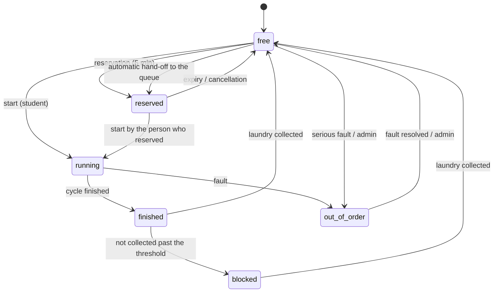

# 🧺 Smart Laundry Campus

An IoT web application for **managing washing machines and dryers in student dormitories**: students see in real time which machines are free, reserve a machine or join a waiting queue, and get notified when their laundry is done. Administrators monitor the machine fleet, faults and consumption.

Built for the Computer Networks course (year 4). The backend is written in **C# (.NET 8)** in a deliberately simple style (only `if` and `for`), with an SQLite database, a vanilla JavaScript single-page frontend and live updates through Server-Sent Events.

> The user interface is in Romanian. UI labels are given in parentheses where they matter, e.g. **Start** (*Pornește*).

---

## Table of contents

1. [Quick start](#1-quick-start)
2. [Features](#2-features)
3. [Architecture](#3-architecture)
4. [Machine lifecycle](#4-machine-lifecycle)
5. [User guide](#5-user-guide)
6. [Real IoT integration](#6-real-iot-integration)
7. [API reference](#7-api-reference)
8. [Database](#8-database)
9. [Configuration and business rules](#9-configuration-and-business-rules)
10. [Security](#10-security)
11. [Project structure](#11-project-structure)
12. [Mapping to the WBS diagram](#12-mapping-to-the-wbs-diagram)
13. [Troubleshooting](#13-troubleshooting)
14. [Limitations and future work](#14-limitations-and-future-work)

---

## 1. Quick start

**Requirements:** [.NET 8 SDK](https://dotnet.microsoft.com/download) (`dotnet --version`). On the first run `dotnet` downloads the `Microsoft.Data.Sqlite` NuGet package on its own (internet access needed).

```bash
cd smart-laundry
dotnet run --project backend
```

Open **http://localhost:3000**.

| Role | Email | Password |
|---|---|---|
| Demo student | `andrei.popescu@student.ro` | `student123` |
| Administrator | `admin@campus.ro` | `admin123` |

The login screen has **Student** and **Administrator** buttons that fill in the demo accounts for you. A new student creates an account from the **Cont nou** (new account) tab.

Seven more seeded students use the same password: `maria.ionescu@`, `radu.muresan@`, `elena.stoica@`, `vlad.dumitru@`, `ioana.pop@`, `tudor.lazar@`, `ana.munteanu@` (all `@student.ro`).

### Environment variables

| Variable | Default | Effect |
|---|---|---|
| `PORT` | `3000` | Server port |
| `ADMIN_PASS` | `admin123` | Admin account password, **applied when the database is created** |
| `DEMO` | on | `DEMO=0` turns off the automatic demo traffic |

Example (PowerShell): `$env:PORT=8080; $env:DEMO=0; dotnet run --project backend`

### Resetting the data

Stop the server and delete `laundry.db` (plus `laundry.db-wal` / `laundry.db-shm`). On the next start the database is recreated and the demo data is loaded again.

---

## 2. Features

### For students
- **Dashboard**: how many washers and dryers are free, how many are running, how many are broken; per-dormitory availability with a status-coloured bar.
- **Machine catalogue** with filters by type (washer / dryer) and status, cards with a progress ring and remaining time.
- **Starting a cycle** by choosing a program (6 programs, each with duration, estimated consumption and price).
- **Live telemetry** in each machine's window: power (W), RPM, vibration, door state, a consumption chart for the last 60 s, and the current phase (pre-wash, wash, rinse, spin).
- **Reservations**: reserve a free machine for 5 minutes, or join the **queue** of a busy one. When it becomes free, the first person in the queue gets it automatically and is notified.
- **Live notifications** (toast + notification centre): cycle finished, reminder, machine blocked by you, reservation activated / expired, fault on your machine, announcements from the admin.
- **Blocked-machine detection**: if you do not collect your laundry after the cycle ends, the machine becomes "Blocked" and you are warned.
- **Fault reporting** with 3 severity levels (a serious fault takes the machine out of service).
- **History and consumption**: cycles, energy (kWh), water (L) and total cost.
- Light / dark theme, responsive interface (phone, tablet, desktop).

### For administrators
- KPIs: cycles, energy, water, revenue, utilisation rate, registered students, broken / blocked machines.
- Charts: cycles per day (14 days), peak hours, energy consumption per dormitory, programs used.
- Fault queue with the flow **Open → In progress → Resolved**; resolving a fault frees the machine automatically and notifies the reporter.
- Machine fleet: add, remove, take out of service, reset, **simulate a fault**, and see each machine's IoT key.
- **Announcements** to all students.
- Configurable **simulation speed** (×1 … ×600).

### The IoT simulator
An internal process (one tick per second) plays the role of the sensors: it generates power, vibration, RPM and water usage depending on the cycle phase, finishes cycles automatically, detects blocked machines, expires reservations and produces rare random faults (abnormal vibration). Optionally, the seeded students start machines and collect their laundry on their own so the dashboard stays "alive".

---

## 3. Architecture

```
┌──────────────┐   HTTP/JSON     ┌───────────────────────────────────────────┐
│  Browser     │ ──────────────► │  C# backend (.NET 8, HttpListener)        │
│  vanilla SPA │ ◄── SSE (live) ─│                                           │
└──────────────┘                 │  ┌────────────┐  ┌─────────────────────┐  │
                                 │  │  REST API  │  │ Simulator / monitor │  │
┌───────────────┐ POST telemetry │  │  + auth    │  │ 1 s tick            │  │
│ ESP32 / sensor│ ──────────────►│  └─────┬──────┘  └──────────┬──────────┘  │
│  (optional)   │  per-machine key│        └────────┬───────────┘             │
└───────────────┘                │           ┌─────▼─────┐                   │
                                 │           │  SQLite   │ laundry.db        │
                                 │           └───────────┘                   │
                                 └───────────────────────────────────────────┘
```

- **Backend:** a C# project in `backend/`, organised into **modules** (see [section 11](#11-project-structure)). HTTP server built on `HttpListener`, one thread per request, a separate thread for the IoT simulator, REST routes, SSE for pushing events to clients, `Microsoft.Data.Sqlite` for persistence. Only one request uses the database at a time (`lock`).
- **Code style:** deliberately simple, only `if` and `for`, with no `while`, `foreach`, `switch`, LINQ or lambdas; JSON is built with small classes (`JObj`, `JArr`).
- **Frontend:** `public/` (HTML + CSS + JS), no framework and no build step. Charts are hand-drawn SVG.
- **Real time:** the server sends events (`tick`, `machines`, `notification`); the client refreshes only what is visible, with throttling, and never overwrites a field you are typing in.

---

## 4. Machine lifecycle



The **offline** state is not stored: a machine that has sent no signal for more than 15 s is shown as "Offline".

When a machine becomes free and people are waiting, it goes straight to `reserved` for the first person in the queue (5 minutes, then it is offered to the next one).

---

## 5. User guide

**Student:**
1. Log in (or create an account) and pick your dormitory from the selector at the top.
2. On the **Dashboard** you see availability; from **Mașini** (machines) you open a machine.
3. Free machine → choose a program → **Pornește** (start). Busy machine → **Intră la coadă** (join the queue).
4. You get a notification when the cycle ends. Press **Mi-am ridicat rufele** (I collected my laundry) to free the machine.
5. Something wrong? **Raportează defecțiune** (report a fault) in the machine's window.
6. Your reservations are under **Rezervări**, your consumption under **Istoric** (history).

**Administrator:**
1. Log in as `admin@campus.ro`; the default page is **Administrare** (administration).
2. Follow the charts and KPIs, send announcements, change the simulation speed.
3. In **Defecțiuni** (faults) move reports through the states *În lucru* (in progress) and *Rezolvat* (resolved).
4. Open any machine to take it out of service, reset it, or see its IoT key.

**Simulation speed.** The default is ×30: a 60-minute program takes 2 real minutes, which keeps demos practical. Set ×1 for real time. A change applies to cycles started afterwards.

---

## 6. Real IoT integration

Each machine has a **device key** (visible to the admin in the machine's window). A microcontroller (e.g. an ESP32 with an SCT-013 current sensor and an accelerometer) can send telemetry periodically:

```bash
curl -X POST http://localhost:3000/api/iot/telemetry \
  -H "Content-Type: application/json" \
  -d '{"machine_id":1,"api_key":"<key>","power_w":1800,"vibration":2.1,"door":"locked","rpm":1100,"water_l":12}'
```

| Field | Required | Description |
|---|---|---|
| `machine_id`, `api_key` | yes | Identifies and authenticates the device |
| `power_w` | yes | Instantaneous power (W) |
| `vibration` | yes | Vibration (mm/s) |
| `door`, `rpm`, `water_l` | no | Door state, RPM, water |

Every message refreshes `last_seen`; with no signal for 15 s the machine shows as "Offline". With `DEMO=0` and real devices on every machine, the sensor simulator is no longer needed.

---

## 7. API reference

Authentication: `Authorization: Bearer <token>` header (`?token=` for SSE). All responses are JSON; errors have the form `{"error":"message"}`.

### Public
| Method | Route | Description |
|---|---|---|
| POST | `/api/register` | `{name,email,password,room,dorm_id}`, creates an account, returns a token |
| POST | `/api/login` | `{email,password}`, returns `{token, role}` |
| POST | `/api/logout` | Invalidates the session |
| GET | `/api/dorms` | Dormitories with availability |
| GET | `/api/programs` | Washing / drying programs |
| GET | `/api/config` | Simulation speed, reservation duration, blocking threshold |
| POST | `/api/iot/telemetry` | Sensor ingestion (device key) |

### Student (authenticated)
| Method | Route | Description |
|---|---|---|
| GET | `/api/me` | Profile, notifications, active reservations |
| GET | `/api/machines?dorm=` | List of machines |
| GET | `/api/machines/:id` | Details + telemetry + machine history |
| POST | `/api/machines/:id/start` | `{program}`, starts the cycle |
| POST | `/api/machines/:id/collect` | Frees the machine after the laundry is collected |
| POST | `/api/machines/:id/reserve` | Reserve (if free) or join the queue (if busy) |
| POST | `/api/reservations/:id/cancel` | Cancels the reservation / queue spot |
| GET | `/api/history` | Last 100 uses |
| GET / POST | `/api/defects` | Own faults / report a new one |
| POST | `/api/notifications/read` | Marks everything as read |
| GET | `/api/stream` | Live SSE stream |

### Administrator
| Method | Route | Description |
|---|---|---|
| GET | `/api/admin/stats` | Aggregated statistics for the charts |
| POST | `/api/admin/defects/:id` | `{status}`: `open`, `in_progress`, `resolved` |
| POST | `/api/admin/machines` | Adds a machine `{dorm_id,type,name}` |
| POST | `/api/admin/machines/:id/{disable,enable,release,fault}` | Actions on a machine |
| DELETE | `/api/admin/machines/:id` | Removes the machine from the network |
| POST | `/api/admin/speed` | `{speed}`, simulation speed |
| POST | `/api/admin/broadcast` | `{message}`, announcement to all students |

Common status codes: `400` invalid data, `401` not logged in, `403` not allowed, `409` state conflict (machine busy, limit reached), `429` too many login attempts.

---

## 8. Database

SQLite, file `laundry.db` (WAL mode), created automatically on startup. Documented schema: [`schema.sql`](schema.sql).

```
dorms ─┬─< machines ─┬─< usage          (cycle history: kWh, water, cost)
       │             ├─< reservations   (active | queued | done | expired | cancelled)
       │             ├─< defects        (source: user | sensor)
       │             └─< telemetry      (kept for 2 hours)
       └─< users ────┬─< sessions       (token, 7-day expiry)
                     ├─< notifications
                     └─< usage / reservations / defects
settings (k/v: simulation speed)
```

Demo data: 4 dormitories, 28 machines, 8 students, 1 admin and ~14 days of synthetic history with realistic peak hours, so the charts look good from the first start.

---

## 9. Configuration and business rules

| Rule | Value |
|---|---|
| Machines per dormitory | 5 washers + 2 dryers (seed) |
| Reservation duration | 5 minutes |
| Simultaneous active cycles | at most 2 per machine type |
| Simultaneous reservations / queue spots | at most 3 per student |
| "Machine blocked" threshold | 15 simulated minutes (at least 60 real seconds) |
| Reminder for forgotten laundry | halfway to the threshold |
| "Offline" machine | no signal for > 15 s |
| Session | 7 days |
| Login | 8 failed attempts / 5 min / IP |

**Programs:**

| Program | Type | Duration | Energy | Water | Price |
|---|---|---|---|---|---|
| Rapid 30° | wash | 30 min | 0.35 kWh | 28 L | 3 lei |
| Standard 40° | wash | 60 min | 0.75 kWh | 45 L | 5 lei |
| Intens 60° | wash | 90 min | 1.3 kWh | 55 L | 7 lei |
| Delicate 30° | wash | 45 min | 0.45 kWh | 40 L | 4 lei |
| Uscare normală | dry | 40 min | 1.8 kWh | – | 4 lei |
| Uscare scurtă | dry | 20 min | 0.9 kWh | – | 2 lei |

Programs are edited in the `Programs` class in `backend/Modules/Machines/Programs.cs`.

---

## 10. Security

- Passwords use **PBKDF2-SHA256** (100,000 iterations, random per-user salt) and are compared in constant time.
- Sessions use a random token stored in the database with an expiry; logging out invalidates the token.
- Login attempts are rate-limited (HTTP 429).
- Admin routes check the role on the server; the frontend is not the only barrier.
- IoT device keys are visible to the admin only.
- SQL queries are parameterised; HTML output in the frontend is escaped; static files are served only from `public/` (path traversal protection); request bodies are limited to 100 KB.

> ⚠️ The project is meant for demonstration and local networks: it runs over plain HTTP. For production, put it behind an HTTPS proxy (nginx, Caddy) and change `ADMIN_PASS` and the demo passwords.

---

## 11. Project structure

```
smart-laundry/
├── backend/                       # C# backend (.NET 8), organised in modules
│   ├── SmartLaundry.csproj        # the project (package: Microsoft.Data.Sqlite)
│   ├── Program.cs                 # startup only: Core, Seed, Simulation, Server
│   │
│   ├── Core/                      # infrastructure, knows nothing about modules
│   │   ├── Database/              # Db, Row, SchemaCreator
│   │   ├── Http/                  # Server, Router, Req, Responses (+Result), StaticFiles, AccessLevel
│   │   ├── Json/                  # J, JObj, JArr, Body
│   │   └── Util.cs
│   │
│   ├── Modules/                   # each module owns its tables
│   │   ├── Auth/                  # AuthController, AuthService, UserRepository, Validators
│   │   ├── Dorms/                 # DormController, DormRepository
│   │   ├── Machines/              # MachineController, MachineService, MachineRepository, MachineView, Programs
│   │   ├── Reservations/          # ReservationController, ReservationService, ReservationRepository
│   │   ├── Defects/               # DefectController, DefectService, DefectRepository
│   │   ├── Notifications/         # NotificationController, NotificationService, NotificationRepository, SseHub
│   │   ├── Usage/                 # UsageController, UsageRepository
│   │   ├── Telemetry/             # TelemetryController, TelemetryService, TelemetryRepository
│   │   └── Admin/                 # AdminController, StatsService, SettingsRepository
│   │
│   ├── Flows/                     # operations that involve several modules
│   │   ├── CycleFlow.cs           # cycle start and finish
│   │   ├── ReleaseFlow.cs         # machine release + hand-off to the queue (+ collect, cancel, expire)
│   │   └── FaultFlow.cs           # fault detected / resolved
│   │
│   ├── Simulation/                # SimulatorLoop, MachineSimulator, BlockDetector, DemoTraffic
│   └── Seed/                      # SeedData (no SQL of its own)
│
├── schema.sql                     # database schema (documentation)
├── README.md                      # documentation
├── laundry.db                     # the database (created on first start)
└── public/
    ├── index.html                 # login + application shell
    ├── style.css                  # light / dark themes, responsive
    └── app.js                     # SPA: pages, modals, SVG charts, SSE client
```

### The layers of a module
- **Controller**: reads the request, calls a Service or a Flow, writes the response. Contains no SQL and no rules.
- **Service**: the module's business rules. Calls only its own Repository and the services of other modules, in one direction only.
- **Repository**: the only place with SQL, and only on the module's own tables. Never calls services or flows.

### Dependency rules
```
Controllers · Simulation · Seed
          │
          ▼
        Flows          (combine the services of several modules)
          │
          ▼
       Services        (Notifications may be called by anyone)
          │
          ▼
     Repositories
          │
          ▼
        Core
```
1. **No cycles between modules:** services do not call each other. When an operation touches several modules (e.g. freeing a machine that has a queue), it lives in a **Flow**.
2. **One table, one owner:** `Telemetry` does not write to the `machines` table directly but goes through `MachineService.UpdateSensorValues`. `SeedData` has no SQL and uses the modules' methods, so the demo data follows the same rules as the application. A declared exception: `StatsService` reads (`SELECT` only) from several tables for the charts.
3. **Roles are checked once, in `Router`**, through `AccessLevel` (`Public`, `Logged`, `Student`, `Admin`); controllers assume the user is already valid. The router answers `401` for anonymous users and `403` for the wrong role.
4. Modules without rules of their own (`Dorms`, `Usage`) have no `Service`; other modules read them through the `Repository`.
5. The simulator goes through the same `TelemetryService.Ingest` and `CycleFlow` as a real sensor, so simulated and real data take the same path.

---

## 12. Mapping to the WBS diagram

| WBS | Requirement | Implementation |
|---|---|---|
| 1.3.1 | Dormitory and machine catalogue | `/api/dorms`, `/api/machines`; 4 dormitories × 7 machines |
| 1.3.2 | State update service | IoT simulator (1 s tick) + `/api/iot/telemetry` |
| 1.3.3 | Remaining-time service | `remaining_ms`, `remaining_sim_min`, progress ring |
| 1.3.4 | Fault records | Student reports + automatic detection, resolution flow |
| 1.4.1 | Dormitory list | Dashboard with per-dormitory availability |
| 1.4.2 | Availability dashboard | KPIs + filters by type and status |
| 1.4.3 | Remaining-time display | Cards + modal with live telemetry |
| 1.4.4 | Fault indicator | Out of order / Offline / Blocked states |
| 1.5.1 | Reservation module | 5-minute reservation + queue with automatic hand-off |
| 1.5.2 | Completion notifications | Live toast + notification centre |
| 1.5.3 | Usage history | History page (cycles, kWh, litres, cost) |
| 1.5.4 | Blocked-machine detection | "Blocked" state + notification to the owner |
| 1.1 / 1.2 / 1.6 / 1.7 | Management, requirements, testing, documentation | This README, `schema.sql`, the API checks described under [Troubleshooting](#13-troubleshooting) |

---

## 13. Troubleshooting

| Problem | Cause / fix |
|---|---|
| `Failed to listen on prefix ... conflicts with an existing registration` | The port is held by an instance that is still running (it shows up under PID 4 in netstat, the http.sys driver). Stop the process by name: `Stop-Process -Name SmartLaundry -Force`, or use another `PORT`. |
| `411 Length Required` on a POST made with curl | `HttpListener` requires `Content-Length`: add `-d "{}"` to POSTs without a body (browsers send it on their own). |
| `dotnet` is not recognised | Install the .NET 8 SDK and reopen the terminal. |
| NuGet package restore error | The first run needs internet access for `Microsoft.Data.Sqlite`. |
| `429 Too many attempts` on login | Wait 5 minutes or restart the server (the counter lives in memory). |
| The interface looks outdated after a change | Hard-reload with `Ctrl+F5`. |
| I want to start from scratch | Stop the server and delete `laundry.db*`. |
| The dashboard is too "dead" / too "busy" | `DEMO=0` turns off the demo traffic; change the simulation speed from Administration. |

**Quick API checks** (e.g. with `curl`): login with a wrong password → `401`; the 9th failure in a row → `429`; a student on an `/api/admin/*` route → `403`; starting a busy machine → `409`; a drying program on a washer → `400`; a request without a token → `401`.

---

## 14. Limitations and future work

- Notifications are in-app only; they could be extended with email / push / Telegram.
- Payment is simulated (only the cost in the history); a payment processor or the student card (NFC) could be integrated.
- A single server instance; scaling would need a network database (PostgreSQL) and an MQTT broker for the sensors.
- No password recovery by email and no email-address confirmation.
- No scheduled reservations by hour; there is only the immediate 5-minute reservation and the queue.
- Occupancy prediction (peak hours) from the history; for now peak hours are only displayed in a chart.
