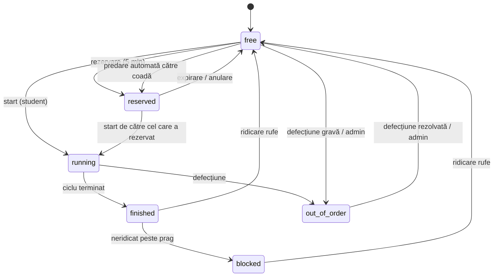

# 🧺 Smart Laundry Campus

Aplicație IoT pentru **gestionarea mașinilor de spălat și a uscătoarelor din căminele studențești**: studenții văd în timp real ce mașini sunt libere, își rezervă locul sau intră la coadă și primesc notificare când rufele sunt gata. Administratorii monitorizează parcul de mașini, defecțiunile și consumul.

Proiect pentru disciplina Rețele de Calculatoare (an 4). Backend **C# (.NET 8)** scris în stil simplu (doar `if` și `for`), bază de date SQLite, frontend SPA în JavaScript simplu, actualizări live prin Server-Sent Events.

---

## Cuprins

1. [Pornire rapidă](#1-pornire-rapidă)
2. [Funcționalități](#2-funcționalități)
3. [Arhitectură](#3-arhitectură)
4. [Ciclul de viață al unei mașini](#4-ciclul-de-viață-al-unei-mașini)
5. [Ghid de utilizare](#5-ghid-de-utilizare)
6. [Integrare IoT reală](#6-integrare-iot-reală)
7. [Referință API](#7-referință-api)
8. [Baza de date](#8-baza-de-date)
9. [Configurare și reguli de business](#9-configurare-și-reguli-de-business)
10. [Securitate](#10-securitate)
11. [Structura proiectului](#11-structura-proiectului)
12. [Corespondență cu diagrama WBS](#12-corespondență-cu-diagrama-wbs)
13. [Depanare](#13-depanare)
14. [Limitări și dezvoltări viitoare](#14-limitări-și-dezvoltări-viitoare)

---

## 1. Pornire rapidă

**Cerințe:** [.NET 8 SDK](https://dotnet.microsoft.com/download) (`dotnet --version`). La prima rulare `dotnet` descarcă singur pachetul NuGet `Microsoft.Data.Sqlite` (necesită internet).

```bash
cd smart-laundry
dotnet run --project backend
```

Deschide **http://localhost:3000**.

| Rol | Email | Parolă |
|---|---|---|
| Student demo | `andrei.popescu@student.ro` | `student123` |
| Administrator | `admin@campus.ro` | `admin123` |

Ecranul de login are butoane „Student” și „Administrator” care completează automat conturile demo. Un student nou își face cont din tabul **Cont nou**.

Alți 7 studenți seed folosesc aceeași parolă: `maria.ionescu@`, `radu.muresan@`, `elena.stoica@`, `vlad.dumitru@`, `ioana.pop@`, `tudor.lazar@`, `ana.munteanu@` (toți `@student.ro`).

### Variabile de mediu

| Variabilă | Implicit | Efect |
|---|---|---|
| `PORT` | `3000` | Portul serverului |
| `ADMIN_PASS` | `admin123` | Parola contului admin, **la crearea bazei** |
| `DEMO` | activ | `DEMO=0` oprește traficul demo automat |

Exemplu (PowerShell): `$env:PORT=8080; $env:DEMO=0; dotnet run --project backend`

### Resetarea datelor

Oprește serverul și șterge `laundry.db` (plus `laundry.db-wal` / `laundry.db-shm`). La următoarea pornire baza se recreează și se reîncarcă datele demo.

---

## 2. Funcționalități

### Pentru studenți
- **Panou de control**: câte mașini de spălat și uscătoare sunt libere, câte rulează, câte sunt defecte; disponibilitate pe fiecare cămin cu bară colorată pe stări.
- **Catalog de mașini** cu filtre pe tip (spălat / uscat) și stare, cartonașe cu inel de progres și timp rămas.
- **Pornirea unui ciclu** cu alegerea programului (6 programe, cu durată, consum estimat și preț).
- **Telemetrie live** în fereastra fiecărei mașini: putere (W), turații, vibrații, stare ușă, grafic de consum pe ultimele 60 s, faza curentă (prespălare, spălare, clătire, centrifugare).
- **Rezervări**: rezervi o mașină liberă pentru 5 minute sau intri la **coadă** la una ocupată. Când se eliberează, primul din coadă o primește automat și e notificat.
- **Notificări** live (toast + centru de notificări): finalizare, reminder, mașină blocată de tine, rezervare activată / expirată, defecțiune a mașinii tale, anunțuri de la admin.
- **Detectarea mașinilor blocate**: dacă nu îți ridici rufele după terminare, mașina devine „Blocată” și ești avertizat.
- **Raportarea defecțiunilor** cu 3 niveluri de gravitate (o defecțiune gravă scoate mașina din uz).
- **Istoric & consum**: cicluri, energie (kWh), apă (L) și cost total.
- Temă luminoasă / întunecată, interfață responsive (telefon, tabletă, desktop).

### Pentru administratori
- KPI-uri: cicluri, energie, apă, încasări, grad de utilizare, studenți înregistrați, mașini defecte / blocate.
- Grafice: cicluri pe zi (14 zile), ore de vârf, consum de energie pe cămin, programe folosite.
- Coada de defecțiuni cu fluxul **Deschis → În lucru → Rezolvat**; rezolvarea eliberează automat mașina și își notifică autorul.
- Parc de mașini: adăugare, ștergere, scoatere din uz, resetare, **simulare de defect**, cheia IoT a fiecărei mașini.
- **Anunț** către toți studenții.
- **Viteza simulării** configurabilă (×1 … ×600).

### Simulatorul IoT
Un proces intern (tick la 1 secundă) joacă rolul senzorilor: generează putere, vibrații, turații și consum de apă în funcție de faza ciclului, închide automat ciclurile, detectează mașinile blocate, expiră rezervările și produce defecțiuni aleatorii rare (vibrații anormale). Opțional, studenții seed pornesc și ridică singuri mașini ca panoul să rămână „viu”.

---

## 3. Arhitectură

```
┌──────────────┐   HTTP/JSON     ┌───────────────────────────────────────────┐
│  Browser     │ ──────────────► │  backend C# (.NET 8, HttpListener)        │
│  SPA vanilla │ ◄── SSE (live) ─│                                           │
└──────────────┘                 │  ┌────────────┐  ┌─────────────────────┐  │
                                 │  │  REST API  │  │ Simulator / monitor │  │
┌──────────────┐  POST telemetrie│  │  + auth    │  │ tick 1 s            │  │
│ ESP32 / senzor│ ──────────────►│  └─────┬──────┘  └──────────┬──────────┘  │
│  (opțional)  │  cheie / mașină │        └────────┬───────────┘             │
└──────────────┘                 │           ┌─────▼─────┐                   │
                                 │           │  SQLite   │ laundry.db        │
                                 │           └───────────┘                   │
                                 └───────────────────────────────────────────┘
```

- **Backend:** proiect C# în `backend/`, organizat pe **module** (vezi [secțiunea 11](#11-structura-proiectului)). Server HTTP cu `HttpListener`, câte un thread pentru fiecare cerere, un thread separat pentru simulatorul IoT, rute REST, SSE pentru push către clienți, `Microsoft.Data.Sqlite` pentru persistență. O singură cerere folosește baza de date la un moment dat (`lock`).
- **Stilul codului:** intenționat simplu, doar `if` și `for`, fără `while`, `foreach`, `switch`, LINQ sau lambda-uri; JSON-ul se construiește cu clase mici (`JObj`, `JArr`).
- **Frontend:** `public/` (HTML + CSS + JS), fără framework și fără build. Graficele sunt SVG desenat manual.
- **Timp real:** serverul trimite evenimente (`tick`, `machines`, `notification`); clientul reîmprospătează doar ce e vizibil, cu throttling, și nu suprascrie câmpurile în care scrii.

---

## 4. Ciclul de viață al unei mașini



Starea **offline** nu e stocată: o mașină care nu trimite semnal de peste 15 s apare ca „Offline”.

Când o mașină se eliberează și are oameni la coadă, trece direct în `reserved` pentru primul din coadă (5 minute, apoi se oferă următorului).

---

## 5. Ghid de utilizare

**Student:**
1. Autentifică-te (sau creează cont) și alege căminul din selectorul de sus.
2. Pe **Panou** vezi disponibilitatea; din **Mașini** deschizi o mașină.
3. Mașină liberă → alegi programul → **Pornește**. Mașină ocupată → **Intră la coadă**.
4. Primești notificare la final. Apasă **Mi-am ridicat rufele** ca să eliberezi mașina.
5. Ceva nu merge? **Raportează defecțiune** din fereastra mașinii.
6. Rezervările tale sunt în **Rezervări**, consumul în **Istoric**.

**Administrator:**
1. Intră cu `admin@campus.ro`; pagina implicită este **Administrare**.
2. Urmărești grafice și KPI, trimiți anunțuri, schimbi viteza simulării.
3. În **Defecțiuni** muți raportările prin stările *În lucru* și *Rezolvat*.
4. Deschizi orice mașină pentru a o scoate din uz, a o reseta sau a-i vedea cheia IoT.

**Viteza simulării.** Implicit ×30: un program de 60 de minute durează 2 minute reale, ceea ce face demonstrația practică. Setează ×1 pentru timp real. Se aplică ciclurilor care pornesc după schimbare.

---

## 6. Integrare IoT reală

Fiecare mașină are o **cheie de dispozitiv** (vizibilă adminului în fereastra mașinii). Un microcontroler (ex. ESP32 cu senzor de curent SCT-013 și accelerometru) poate trimite periodic telemetrie:

```bash
curl -X POST http://localhost:3000/api/iot/telemetry \
  -H "Content-Type: application/json" \
  -d '{"machine_id":1,"api_key":"<cheie>","power_w":1800,"vibration":2.1,"door":"locked","rpm":1100,"water_l":12}'
```

| Câmp | Obligatoriu | Descriere |
|---|---|---|
| `machine_id`, `api_key` | da | Identifică și autentifică dispozitivul |
| `power_w` | da | Puterea instantanee (W) |
| `vibration` | da | Vibrații (mm/s) |
| `door`, `rpm`, `water_l` | nu | Stare ușă, turații, apă |

Fiecare mesaj reîmprospătează `last_seen`; fără semnal 15 s mașina apare „Offline”. Cu `DEMO=0` și dispozitive reale pe toate mașinile, simulatorul nu mai e necesar pentru senzori.

---

## 7. Referință API

Autentificare: antet `Authorization: Bearer <token>` (la SSE, `?token=`). Toate răspunsurile sunt JSON; erorile au forma `{"error":"mesaj"}`.

### Public
| Metodă | Rută | Descriere |
|---|---|---|
| POST | `/api/register` | `{name,email,password,room,dorm_id}`, creează cont, întoarce token |
| POST | `/api/login` | `{email,password}`, întoarce `{token, role}` |
| POST | `/api/logout` | Invalidează sesiunea |
| GET | `/api/dorms` | Cămine cu disponibilitate |
| GET | `/api/programs` | Programele de spălare / uscare |
| GET | `/api/config` | Viteza simulării, durata rezervării, pragul de blocare |
| POST | `/api/iot/telemetry` | Ingestie senzori (cheie de dispozitiv) |

### Student (autentificat)
| Metodă | Rută | Descriere |
|---|---|---|
| GET | `/api/me` | Profil, notificări, rezervări active |
| GET | `/api/machines?dorm=` | Lista mașinilor |
| GET | `/api/machines/:id` | Detalii + telemetrie + istoric mașină |
| POST | `/api/machines/:id/start` | `{program}`, pornește ciclul |
| POST | `/api/machines/:id/collect` | Eliberează mașina după ridicarea rufelor |
| POST | `/api/machines/:id/reserve` | Rezervă (liberă) sau intră la coadă (ocupată) |
| POST | `/api/reservations/:id/cancel` | Anulează rezervarea / coada |
| GET | `/api/history` | Ultimele 100 de utilizări |
| GET / POST | `/api/defects` | Defecțiunile proprii / raportare nouă |
| POST | `/api/notifications/read` | Marchează tot ca citit |
| GET | `/api/stream` | Flux SSE live |

### Administrator
| Metodă | Rută | Descriere |
|---|---|---|
| GET | `/api/admin/stats` | Statistici agregate pentru grafice |
| POST | `/api/admin/defects/:id` | `{status}`: `open`, `in_progress`, `resolved` |
| POST | `/api/admin/machines` | Adaugă mașină `{dorm_id,type,name}` |
| POST | `/api/admin/machines/:id/{disable,enable,release,fault}` | Acțiuni asupra mașinii |
| DELETE | `/api/admin/machines/:id` | Scoate mașina din rețea |
| POST | `/api/admin/speed` | `{speed}`, viteza simulării |
| POST | `/api/admin/broadcast` | `{message}`, anunț către toți studenții |

Coduri frecvente: `400` date invalide, `401` neautentificat, `403` fără drepturi, `409` conflict de stare (mașină ocupată, limită atinsă), `429` prea multe încercări de login.

---

## 8. Baza de date

SQLite, fișierul `laundry.db` (mod WAL), creat și migrat automat la pornire. Schema documentată: [`schema.sql`](schema.sql).

```
dorms ─┬─< machines ─┬─< usage          (istoric cicluri: kWh, apă, cost)
       │             ├─< reservations   (active | queued | done | expired | cancelled)
       │             ├─< defects        (sursă: user | sensor)
       │             └─< telemetry      (păstrată 2 ore)
       └─< users ────┬─< sessions       (token, expirare 7 zile)
                     ├─< notifications
                     └─< usage / reservations / defects
settings (k/v: viteza simulării)
```

Datele demo: 4 cămine, 28 de mașini, 8 studenți, 1 admin și ~14 zile de istoric sintetic cu ore de vârf realiste, pentru ca graficele să arate bine din prima.

---

## 9. Configurare și reguli de business

| Regulă | Valoare |
|---|---|
| Mașini pe cămin | 5 de spălat + 2 uscătoare (seed) |
| Durata rezervării | 5 minute |
| Cicluri active simultan | maximum 2 per tip de mașină |
| Rezervări / cozi simultane | maximum 3 per student |
| Prag „mașină blocată” | 15 minute simulate (minimum 60 s reale) |
| Reminder rufe uitate | la jumătatea pragului |
| Mașină „Offline” | fără semnal > 15 s |
| Sesiune | 7 zile |
| Login | 8 încercări greșite / 5 min / IP |

**Programe:**

| Program | Tip | Durată | Energie | Apă | Preț |
|---|---|---|---|---|---|
| Rapid 30° | spălat | 30 min | 0,35 kWh | 28 L | 3 lei |
| Standard 40° | spălat | 60 min | 0,75 kWh | 45 L | 5 lei |
| Intens 60° | spălat | 90 min | 1,3 kWh | 55 L | 7 lei |
| Delicate 30° | spălat | 45 min | 0,45 kWh | 40 L | 4 lei |
| Uscare normală | uscat | 40 min | 1,8 kWh | – | 4 lei |
| Uscare scurtă | uscat | 20 min | 0,9 kWh | – | 2 lei |

Programele se editează în clasa `Programs` din `backend/Modules/Machines/Programs.cs`.

---

## 10. Securitate

- Parole cu **PBKDF2-SHA256** (100.000 de iterații, sare aleatoare per utilizator), comparare în timp constant.
- Sesiuni cu token aleator în baza de date, cu expirare; logout invalidează tokenul.
- Limitare a încercărilor de login (HTTP 429).
- Rutele de admin verifică rolul pe server; frontend-ul nu e singura barieră.
- Cheile dispozitivelor IoT sunt vizibile doar adminului.
- Interogări SQL parametrizate; ieșirea HTML din frontend este escapată; fișierele statice sunt servite doar din `public/` (protecție la path traversal); corpurile cererilor sunt limitate la 100 KB.

> ⚠️ Proiectul e gândit pentru demonstrație și rețea locală: rulează pe HTTP simplu. Pentru producție pune-l în spatele unui proxy HTTPS (nginx, Caddy), schimbă `ADMIN_PASS` și parolele demo.

---

## 11. Structura proiectului

```
smart-laundry/
├── backend/                       # backend C# (.NET 8), pe module
│   ├── SmartLaundry.csproj        # proiectul (pachet: Microsoft.Data.Sqlite)
│   ├── Program.cs                 # doar pornirea: Core, Seed, Simulation, Server
│   │
│   ├── Core/                      # infrastructură, nu știe de module
│   │   ├── Database/              # Db, Row, SchemaCreator
│   │   ├── Http/                  # Server, Router, Req, Responses (+Result), StaticFiles, AccessLevel
│   │   ├── Json/                  # J, JObj, JArr, Body
│   │   └── Util.cs
│   │
│   ├── Modules/                   # fiecare modul își deține tabelele
│   │   ├── Auth/                  # AuthController, AuthService, UserRepository, Validators
│   │   ├── Dorms/                 # DormController, DormRepository
│   │   ├── Machines/              # MachineController, MachineService, MachineRepository, MachineView, Programs
│   │   ├── Reservations/          # ReservationController, ReservationService, ReservationRepository
│   │   ├── Defects/               # DefectController, DefectService, DefectRepository
│   │   ├── Notifications/         # NotificationController, NotificationService, NotificationRepository, SseHub
│   │   ├── Usage/                 # UsageController, UsageRepository
│   │   ├── Telemetry/             # TelemetryController, TelemetryService, TelemetryRepository
│   │   └── Admin/                 # AdminController, StatsService, SettingsRepository
│   │
│   ├── Flows/                     # operații care implică mai multe module
│   │   ├── CycleFlow.cs           # pornire și terminare ciclu
│   │   ├── ReleaseFlow.cs         # eliberare mașină + predare către coadă (+ colectare, anulare, expirare)
│   │   └── FaultFlow.cs           # defect detectat / rezolvat
│   │
│   ├── Simulation/                # SimulatorLoop, MachineSimulator, BlockDetector, DemoTraffic
│   └── Seed/                      # SeedData (fără SQL propriu)
│
├── schema.sql                     # schema bazei de date (documentație)
├── README.md
├── laundry.db                     # baza de date (creată la prima pornire)
└── public/
    ├── index.html                 # login + shell-ul aplicației
    ├── style.css                  # teme luminoasă / întunecată, responsive
    └── app.js                     # SPA: pagini, modale, grafice SVG, client SSE
```

### Straturile unui modul
- **Controller**: citește cererea, apelează un Service sau un Flow, scrie răspunsul. Nu conține SQL și nu conține reguli.
- **Service**: regulile de business ale modulului. Apelează doar propriul Repository și serviciile altor module, într-un singur sens.
- **Repository**: singurul loc cu SQL, doar pe tabelele modulului. Nu apelează servicii sau flow-uri.

### Reguli de dependență
```
Controllers · Simulation · Seed
          │
          ▼
        Flows          (combină serviciile mai multor module)
          │
          ▼
       Services        (Notifications poate fi apelat de oricine)
          │
          ▼
     Repositories
          │
          ▼
        Core
```
1. **Fără cicluri între module:** serviciile nu se apelează reciproc. Când o operație atinge mai multe module (ex. eliberarea unei mașini care are coadă), ea stă într-un **Flow**.
2. **Un tabel, un proprietar:** `Telemetry` nu scrie direct în tabelul `machines`, ci prin `MachineService.UpdateSensorValues`. `SeedData` nu are SQL, ci folosește metodele modulelor, deci datele demo respectă aceleași reguli ca aplicația. Excepție declarată: `StatsService` citește (doar `SELECT`) din mai multe tabele pentru grafice.
3. **Rolurile se verifică o singură dată, în `Router`**, prin `AccessLevel` (`Public`, `Logged`, `Student`, `Admin`); controllerele presupun că utilizatorul e deja valid. Router-ul răspunde `401` pentru nelogat și `403` pentru rol greșit.
4. Modulele fără reguli proprii (`Dorms`, `Usage`) nu au `Service`; celelalte module le citesc prin `Repository`.
5. Simulatorul trece prin aceleași `TelemetryService.Ingest` și `CycleFlow` ca un senzor real, deci simulatul și realul au același drum.

---

## 12. Corespondență cu diagrama WBS

| WBS | Cerință | Implementare |
|---|---|---|
| 1.3.1 | Catalog căminelor și mașinilor | `/api/dorms`, `/api/machines`; 4 cămine × 7 mașini |
| 1.3.2 | Serviciu de actualizare a stărilor | Simulator IoT (tick 1 s) + `/api/iot/telemetry` |
| 1.3.3 | Serviciu timp rămas | `remaining_ms`, `remaining_sim_min`, inel de progres |
| 1.3.4 | Evidența defecțiunilor | Raportare student + detectare automată, flux de rezolvare |
| 1.4.1 | Lista căminelor | Panou cu disponibilitate pe cămin |
| 1.4.2 | Panou de disponibilitate | KPI-uri + filtre pe tip și stare |
| 1.4.3 | Afișaj timp rămas | Cartonașe + modal cu telemetrie live |
| 1.4.4 | Indicator defecțiuni | Stări Defectă / Offline / Blocată |
| 1.5.1 | Modul de rezervări | Rezervare 5 min + coadă cu predare automată |
| 1.5.2 | Notificări de finalizare | Toast live + centru de notificări |
| 1.5.3 | Istoric utilizări | Pagina Istoric (cicluri, kWh, litri, cost) |
| 1.5.4 | Detectare mașini blocate | Stare „Blocată” + notificare proprietar |
| 1.1 / 1.2 / 1.6 / 1.7 | Management, cerințe, testare, documentație | Acest README, `schema.sql`, testele de API descrise la [Depanare](#13-depanare) |

---

## 13. Depanare

| Problemă | Cauză / soluție |
|---|---|
| `Failed to listen on prefix ... conflicts with an existing registration` | Portul e ocupat de o instanță rămasă pornită (în netstat apare sub PID 4, driverul http.sys). Oprește procesul după nume: `Stop-Process -Name SmartLaundry -Force`, sau folosește alt `PORT`. |
| `411 Length Required` la un POST făcut cu curl | `HttpListener` cere `Content-Length`: adaugă `-d "{}"` la POST-urile fără body (browserul îl trimite singur). |
| `dotnet` nu e recunoscut | Instalează .NET 8 SDK și redeschide terminalul. |
| Eroare la restaurarea pachetelor NuGet | Prima rulare are nevoie de internet pentru `Microsoft.Data.Sqlite`. |
| | `429 Prea multe încercări` la login | Aștepți 5 minute sau repornești serverul (contorul e în memorie). |
| Interfața arată vechi după o modificare | Reîncarcă forțat cu `Ctrl+F5`. |
| Vreau să încep de la zero | Oprește serverul și șterge `laundry.db*`. |
| Panoul e prea „mort” / prea „agitat” | `DEMO=0` oprește traficul demo; viteza simulării se schimbă din Administrare. |

**Verificări rapide prin API** (ex. cu `curl`): login cu parolă greșită → `401`; al 9-lea eșec la rând → `429`; student pe rută `/api/admin/*` → `403`; pornire pe mașină ocupată → `409`; program de uscare pe mașină de spălat → `400`; cerere fără token → `401`.

---

## 14. Limitări și dezvoltări viitoare

- Notificările sunt doar în aplicație; pot fi extinse cu email / push / Telegram.
- Plata este simulată (doar costul din istoric); poate fi integrat un procesor de plăți sau cartea de student (NFC).
- O singură instanță de server; pentru scalare ar trebui o bază de date de rețea (PostgreSQL) și un broker MQTT pentru senzori.
- Fără recuperare de parolă prin email și fără confirmarea adresei de email.
- Fără rezervări programate pe ore; există doar rezervarea imediată de 5 minute și coada.
- Predicții de ocupare (ore de vârf) pe baza istoricului; acum sunt doar afișate în grafic.
